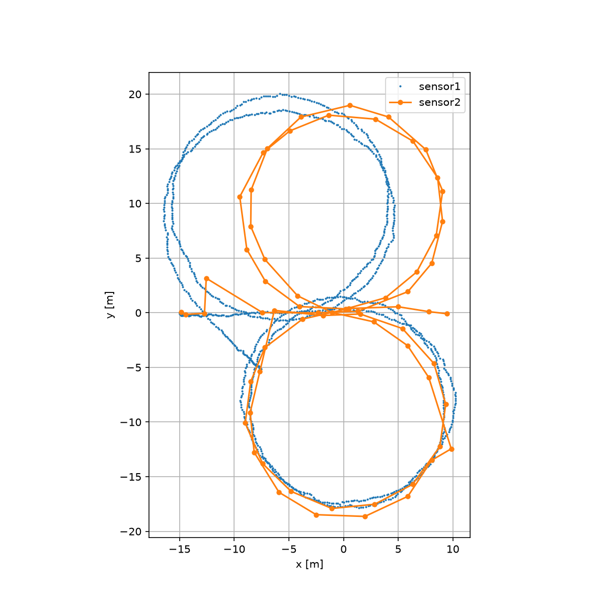
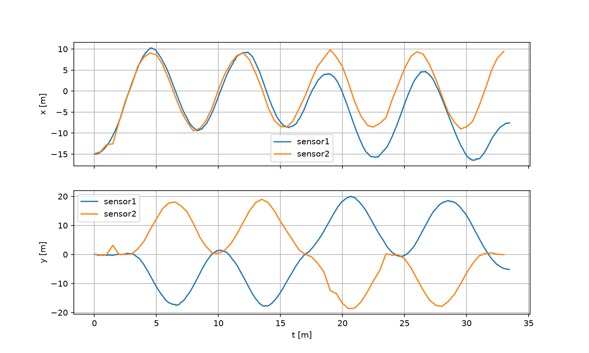

# Zadanie 2

## 2.1 Analiza błędów sensorów

### Narzędzia
Dane przeanalizowałem w Pythonie (pandas, matplotlib).

### Sensor 1

**Obserwacje:**
- trajektoria gładka i mało zaszumiona,
- dobry kierunek najpierw okrąg prawy, potem lewy,
- pierwsze dwa okrążenia prawie idealnie pokrywają się z torem, potem trajektoria zaczyna odpływać,
- błąd rośnie z czasem: na początku mały, potem coraz większy. Na końcu przejazdu sensor wskazuje ok. (−7.6, −5.2), podczas gdy auto powinno stać ok. 10 m za linią pomiaru czasu,
- odpływanie jest znacznie większe w osi x niż w y.

**Podejrzewane źródło:** czujnik to prawdopodobnie akcelerometr wiec błąd w nim jest prawdopodobnie: blad kalibracji, wpływ temperatury lub bład w montażu.

### Sensor 2

**Obserwacje:**
- pozycja nie odpływa w czasie: start i koniec zgadzają się z treścią zadania ((−15, 0) i ok. 10 m za linią),
- pomiary mają 3 wyraźne błedy, i są dużo rzadsze niż przy sensorze 1
- oś y jest odwrócona: sensor wskazuje najpierw okrąg lewy,

**Podejrzewane źródło:** odbiornik GPS, błędy tutaj mogą wynikać z chwilowej utraty satelitów lub zakłóceń

## 2.2
Sensory mają uzupełniające się wady: sensor 1 jest częsty i gładki, ale odpływa w długim okresie, a sensor 2 jest rzadki i zaszumiony, ale nie odpływa. Dlatego trzeba skorygować dryf sensora 1 pozycją sensora 2.

Niestety nie zdążyłem napisać programu do tego podpunktu. Plan rozwiązania:
1. Wczytać oba pliki CSV i odwrócić oś y w sensorze 2.
2. Pozycję sensora 1 w dowolnej chwili t liczyć interpolacją liniową między dwoma sąsiednimi pomiarami, bo czasy pomiarów nie pokrywają się z T ani z pomiarami sensora 2.
3. W chwilach pomiarów sensora 2 policzyć różnicę e(t) = sensor1(t) − sensor2(t), czyli o ile sensor 1 odpłynął.
4. Odrzucić odskoki sensora 2 i dopasować do e(t) gładką krzywą (np. a·t² , osobno dla x i y).
5. Dla zadanego T: pozycja = sensor1(T) − dryf(T).
6. Pętla „Podaj T” z kontrolą zakresu 0–33.